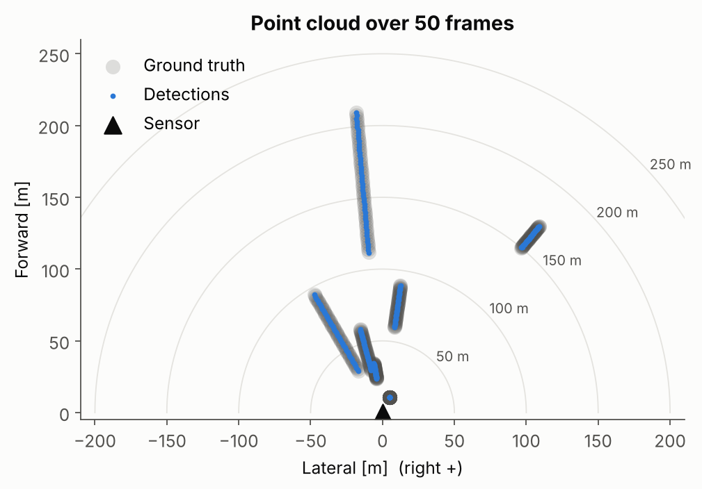
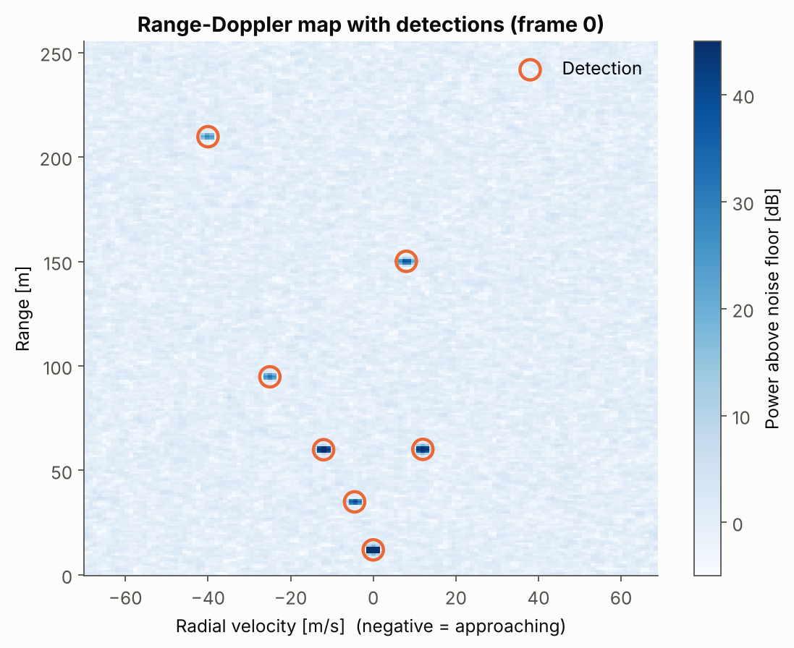
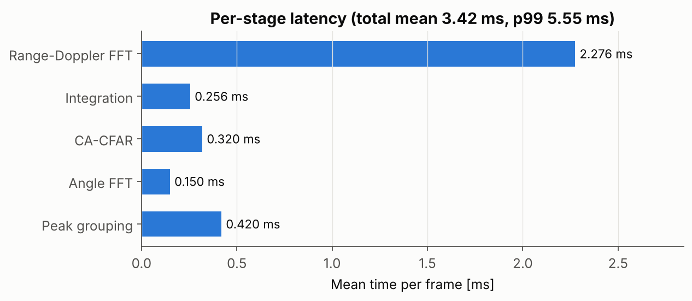
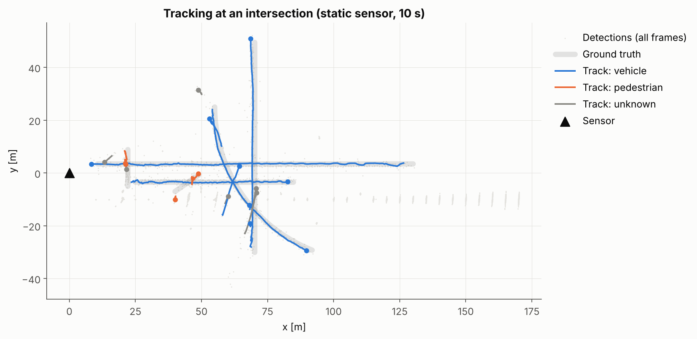

# RADAR Perception (C++)

[](https://github.com/22by7-raikar/RADAR_Perception_CPP/actions/workflows/ci.yml)

A real-time FMCW radar perception stack in modern C++. It takes raw IQ ADC
frames and produces a point cloud (range, radial velocity, azimuth), then
tracked and classified objects. It comes with a physically grounded
simulator, unit tests, benchmarks and CI.



## Highlights

- **End-to-end pipeline:** windowed range-Doppler FFT → non-coherent
  integration over channels → 2D CA-CFAR → multi-peak angle FFT → 3D peak
  grouping → point cloud → DBSCAN clusters → EKF multi-object tracks with a
  class label.
- **About 3 ms per frame** on one CPU core, for 256 samples × 128 chirps × 8
  receive channels. That is under 6% of a 20 Hz frame budget.
- **CFAR set by false-alarm rate.** The threshold multiplier is solved
  exactly for square-law detection with *K* integrated looks. You set a
  target Pfa, not a hand-tuned dB offset. A test checks that the measured
  false-alarm rate matches the design value.
- **O(1) CFAR per cell** using a summed-area table, so cost doesn't depend on
  window size.
- **No blind edges.** The Doppler axis wraps around, because velocity
  aliases. Range windows are clipped at the edges, with the threshold
  recomputed for the smaller training set.
- **Production setup:** CMake with pinned dependencies, GoogleTest, Google
  Benchmark, GCC and Clang builds with `-Werror`, ASan/UBSan, clang-format, and
  GitHub Actions CI.

## Results

Default scene (`scenarios/multi_target.csv`): 7 targets from 12 m to 210 m,
including two at the same range with opposite velocities, simulated over 50
frames at 20 Hz:

| Metric | Value |
|---|---|
| Detection rate | 100 % (350 / 350) |
| False alarms | 0.00 per frame (design Pfa 1e-6, plus a 10 dB SNR floor per angle peak) |
| Mean absolute range error | 0.11 m (bin size 1.0 m) |
| Mean absolute velocity error | 0.02 m/s (bin size 1.09 m/s) |
| Mean absolute azimuth error | 0.02° |
| Latency, mean / p99 | ≈ 3 ms / ≈ 5 ms |



Edge-case scene (`scenarios/edge_cases.csv`): targets at 3 m, at ±68.5 m/s
right next to the velocity wrap, at 245 m and at 55° azimuth. 99.6 % are
detected.

### Latency breakdown



Google Benchmark, single thread, 4-core 2.8 GHz x86-64 VM, Release build:

| Stage | Time |
|---|---|
| Range-Doppler FFT (8 × 128 × 256 complex) | 1.6 ms |
| Non-coherent integration | 0.18 ms (was 0.49 ms before removing `std::norm` and strided writes) |
| 2D CA-CFAR (32k cells) | 0.3 ms |
| Full pipeline | 2.6 ms |

## Radar configuration

| Parameter | Value | Gives |
|---|---|---|
| Carrier | 77 GHz | λ = 3.9 mm |
| Sweep bandwidth | 150 MHz | 1.0 m range resolution |
| Chirp / idle time | 12 µs / 2 µs | ±69.5 m/s unambiguous velocity |
| Samples per chirp | 256 (complex, 21.3 MS/s) | 256 m max range |
| Chirps per frame | 128 | 1.09 m/s velocity resolution |
| Receive channels | 8, λ/2 spacing | about 14° angular resolution, ±90° field of view |

Everything lives in `radar::RadarConfig`. Every derived quantity is computed
from these values and covered by tests.

## Pipeline

```
 IQ frame [rx][chirp][sample]
   │
   ├─ Range-Doppler FFT ── Hann × Hann taper; zero-Doppler centring folded into the taper
   │                       as a (−1)^m modulation, so there is no separate fftshift pass
   ├─ Integration ──────── Σ_k |X_k(r, d)|², power map (range × Doppler)
   ├─ CA-CFAR ──────────── summed-area table; Doppler wrap; range-edge clipping;
   │                       exact Gamma(K) threshold for the requested Pfa
   ├─ Angle FFT ────────── zero-padded FFT over channels; up to 2 azimuth peaks per cell
   ├─ Peak grouping ────── 3D non-maximum suppression over (range, Doppler, azimuth)
   ├─ Sub-bin refinement ─ log-parabolic interpolation in range and Doppler
   └─ SNR / RCS ────────── against the global noise floor; RCS via a calibrated offset
   ▼
 std::vector<radar::Detection>
   │
   ├─ DBSCAN ───────────── (x, y, v_r) with per-axis radii → clusters with extent, RCS, Doppler spread
   ├─ Tracker ──────────── CV-EKF on [x, y, vx, vy] with a radial-velocity measurement;
   │                       Hungarian GNN; M-of-N confirmation; extended-object absorb gate
   └─ Classifier ───────── evidence accumulation: RCS, extent, micro-Doppler spread, motion
   ▼
 std::vector<radar::Track>
```

### Signal model

The simulator generates the dechirped beat signal from the exact round-trip
delay of every sample on every channel:

```
τ_k(t) = 2 (R₀ + v t) / c − k d sin(θ) / c
s_k(t) = A · exp(j 2π (f_c τ + S t_fast τ − S τ² / 2)) + n(t)
```

Range migration within the frame and range-Doppler coupling come out of this
naturally. Echo amplitude follows the radar equation (SNR ∝ RCS / R⁴),
relative to a configurable reference target. Noise is complex white Gaussian.

### CFAR threshold

When *K* channels are summed, each cell's noise follows a Gamma(*K*)
distribution, and the sum of *N* training cells follows Gamma(*NK*). The
detector finds the multiplier *t* for which

```
Pfa = Σ_{i=0}^{K−1} C(NK + i − 1, i) · tⁱ / (1 + t)^{NK + i}
```

equals the requested false-alarm probability. For *K* = 1 this reduces to
the textbook `t = Pfa^(−1/N) − 1`, and a unit test checks that case. *N*
shrinks at range edges, so the multiplier is cached for each distinct *N*.

## Object-level perception

`tracking_demo` runs the full chain on a simulated intersection seen from a
static sensor for 10 s at 20 Hz:
- four vehicles (crossing, oncoming, receding, turning), each modelled as 10
  scatterers on its outline, with self-occlusion;
- two pedestrians whose swinging limbs spread their Doppler (micro-Doppler);
- six poles and a 160 m barrier as static clutter.



| Metric (dynamic objects) | Value |
|---|---|
| MOTA | 0.67 |
| Recall | 0.86 |
| MOTP (track vs. object centre) | 1.6 m |
| Mean velocity error | 0.9 m/s |
| ID switches | 14 in 1200 object-frames |
| Class accuracy, vehicles | 99 % |
| Class accuracy, pedestrians | 47 % (39 % confused with static, see below) |
| Clustering + tracking latency | 0.3 ms per frame |

Design points:

- **Radial velocity in the measurement model.** The EKF measures
  `[x, y, v_r]`, where `v_r = d·(v − v_sensor)/|d|`. That expression doesn't
  depend on the sensor's rotation, so the radial channel needs no
  ego-rotation correction. New tracks start with a velocity along the line of
  sight and a wide tangential uncertainty, because only the radial component
  has been observed.
- **Extended objects.** A vehicle returns 2–6 points that sometimes split
  into separate clusters. An oriented gate, long along the track's heading
  and narrow across it, assigns leftover clusters to the existing track.
  Two cars in adjacent lanes stay separate.
- **3D peak grouping.** A weak reflector that shares a range-Doppler cell
  with a stronger one at a different angle is kept. 2D peak suppression
  removed the crossing pedestrian completely: its echo shared cells with a
  pole and barrier posts.
- **RCS from the global noise floor.** SNR against the local CFAR estimate
  under-reads by 20–40 dB on the zero-Doppler clutter ridge. The noise floor
  comes from the median of the power map (the Gamma(K) median-to-mean ratio
  converts it), and the RCS offset is calibrated with a simulated 10 dBsm
  reflector.
- **Static vs. moving.** A track counts as static when it hasn't moved
  further than its position uncertainty explains *and* it shows no Doppler
  spread and no ego-compensated radial velocity. A tangential velocity close
  to zero isn't enough on its own: angle noise at 150 m produces the same
  numbers.

**Known limitation:** a pedestrian walking across the line of sight has a
near-zero radial velocity, so its echo falls on the static clutter ridge.
Its angle is estimated from a cell it shares with poles and posts, which
makes lateral position jitter by about ±1.5 m. The track survives, but its
velocity estimate is weak, and many such frames end up classified static.
Scoring counts that as a class error, not a miss.

## Layout

```
include/radar/   Signal: config, simulator, range_doppler, cfar, angle, pipeline
                 Objects: geometry, scene, scenarios, clustering, assignment, tracker, tracking_metrics
                 Utilities: evaluation, io
src/             Implementation
apps/            radar_demo (point cloud), tracking_demo (objects)
tests/           GoogleTest suite (59 tests)
bench/           Google Benchmark suite
scenarios/       Target scenarios (CSV)
tools/           plot_results.py, plot_tracking.py: figures from demo output
```

## Build and run

Requires CMake ≥ 3.20, a C++17 compiler and Eigen 3.3+ (`apt install
libeigen3-dev`; if it's missing, Eigen is fetched). pocketfft, GoogleTest and
Google Benchmark are fetched at pinned versions.

```bash
cmake -S . -B build -G Ninja -DCMAKE_BUILD_TYPE=Release
cmake --build build
ctest --test-dir build --output-on-failure
```

```bash
./build/radar_demo --scenario scenarios/multi_target.csv --frames 50 --out out
./build/bench/radar_bench
python3 tools/plot_results.py out docs/images   # needs numpy + matplotlib
./build/tracking_demo --scenario intersection --out out_tracking
python3 tools/plot_tracking.py out_tracking docs/images/tracking_intersection.png
```

CMake options:

| Option | Default | |
|---|---|---|
| `RP_BUILD_TESTS` / `RP_BUILD_BENCHMARKS` / `RP_BUILD_APPS` | ON | |
| `RP_ENABLE_SANITIZERS` | OFF | ASan + UBSan |
| `RP_WARNINGS_AS_ERRORS` | OFF | ON in CI |
| `RP_NATIVE_ARCH` | OFF | `-march=native`, off by default so cross-compiling stays portable |

### Using the library

```cpp
#include "radar/pipeline.hpp"

radar::RadarConfig cfg;              // or set your own front-end parameters
radar::RadarPipeline pipeline(cfg);
radar::FrameResult result;

pipeline.process(adc_frame, result); // adc_frame: radar::DataCube [rx][chirp][sample]
for (const auto& d : result.detections) {
  // d.range_m, d.velocity_mps, d.azimuth_rad, d.x_m, d.y_m, d.snr_db
}
```

The pipeline owns and reuses all its working buffers, so steady-state
processing does not allocate.

## Roadmap

- [x] **Signal processing core:** range-Doppler, CFAR, angle estimation, point cloud
- [x] **Object level:** DBSCAN clustering in (x, y, v), multi-target tracking (EKF with track management), classification
- [ ] **Ego-motion:** ego-velocity from stationary-point Doppler (RANSAC), fused with an IMU in an error-state Kalman filter
- [ ] **Camera fusion:** extrinsic calibration, time sync and projecting radar points into images, on public radar + camera data
- [ ] **Deployment:** ROS 2 nodes, ARM64 cross-compilation, embedded latency profiling, data-driven regression tests
- [ ] **Performance:** TDM-MIMO virtual array, multithreaded per-channel FFTs

## License

MIT
